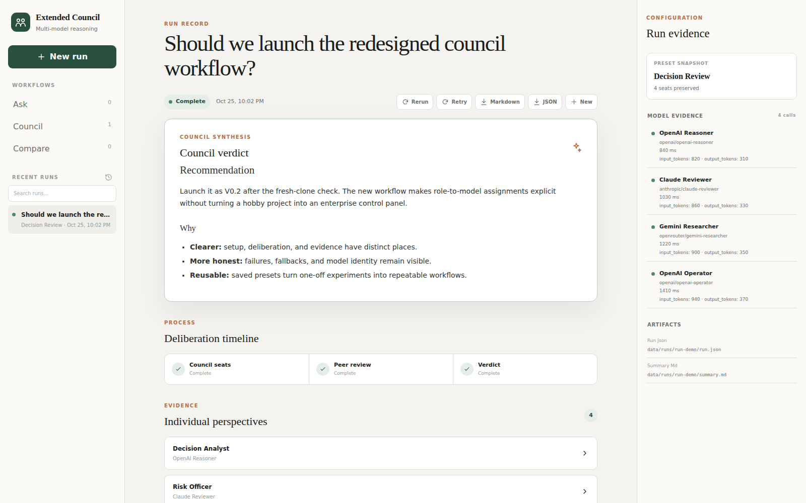

<p align="center">
  
</p>

<h1 align="center">Extended Council</h1>

<p align="center">
  A local-first, multi-model reasoning workbench with explicit roles.<br>
  Choose which model occupies each seat, inspect the deliberation, and keep the result.
</p>

<p align="center">
  <a href="https://github.com/Pilvik1/extended-llm-council/actions/workflows/ci.yml"></a>
  
  
  
</p>

> **Status:** V0.2 is a usable hobby release, not a decision oracle. Ask, Council,
> and Compare work through one persistent run lifecycle. Provider quality, speed,
> pricing, and availability still depend on the accounts and models you configure.

## Why it exists

The original LLM Council pattern gets several models to answer independently,
anonymously review one another, and synthesize a result. Extended Council keeps
that useful core and adds structure around it:

- reasoning roles and model assignments are separate;
- every seat can use a different provider or model;
- presets make useful councils reusable;
- failures, fallbacks, latency, usage, and model identity remain visible; and
- runs survive application restarts as inspectable JSON and Markdown artifacts.

The goal is personal utility, not a SaaS costume. It helps pressure-test a
decision, review code, compare options, or interrogate an investment thesis
without pretending that five model calls equal truth.

## Five-minute start

### Requirements

- Python 3.10+
- [uv](https://docs.astral.sh/uv/getting-started/installation/)
- Node.js 22+
- at least one OpenAI, Anthropic, or OpenRouter API key

### Install

```bash
git clone https://github.com/Pilvik1/extended-llm-council.git
cd extended-llm-council
uv sync --frozen --group dev
cd frontend && npm ci && cd ..
cp .env.example .env
```

Add at least one provider key to `.env`:

```dotenv
OPENAI_API_KEY=
ANTHROPIC_API_KEY=
OPENROUTER_API_KEY=
```

Then start both services:

```bash
./start.sh
```

Open [http://localhost:5173](http://localhost:5173). The API binds to
`127.0.0.1:8001`; wider network exposure is not enabled by default.

## Core workflows

### Ask

Send one question to independently configured respondents, anonymize their
answers for peer review, and synthesize a final answer.

### Council

Assign reasoning roles to model seats and pressure-test a question, decision,
plan, or artifact. Built-in presets include:

- General Council
- Decision Review
- Code Review
- Investment Case
- Red Team

Roles and models are deliberately independent. Changing a Contrarian from one
model to another does not change its role prompt; changing the role does not
require touching provider configuration.

### Compare

Evaluate two or more named options against explicit criteria. Independent
comparisons and the final synthesis remain available for inspection instead of
being flattened into an unexplained winner.

## What works today

- explicit role → model assignment for every council seat;
- OpenAI, Anthropic, and OpenRouter provider adapters;
- independent responses, anonymized peer review, and synthesis;
- editable built-in presets plus saved local copies;
- persistent run history, search, reopen, rerun, retry, and cancellation;
- requested and actual provider/model identity, including fallbacks;
- provider-reported latency and token usage when available;
- Markdown and canonical JSON export;
- responsive desktop and mobile workbench; and
- legacy V0.1 conversation and case artifacts remain readable.

## Architecture

```text
React workbench
      │
  FastAPI API
      │
run lifecycle + preset snapshot
   ┌──┴───────────┐
   │              │
provider aliases  JSON / Markdown artifacts
   │              │
OpenAI · Anthropic · OpenRouter
```

The application keeps JSON as the system of record for V0.2:

```text
data/
├── presets/<preset-id>.json
└── runs/<run-id>/
    ├── run.json
    └── summary.md
```

Each run stores an immutable preset snapshot. Editing a saved preset later does
not rewrite the meaning of historical runs.

## Configuration

Model aliases live in [`backend/config.py`](backend/config.py). The neutral V0.2
environment variables are:

```dotenv
COUNCIL_RESPONDENT_MODELS=openai_primary,openrouter_free,claude_primary
COUNCIL_REVIEWER_MODELS=openai_primary,openrouter_free,claude_primary
COUNCIL_SYNTHESIZER_MODEL=openai_primary
COUNCIL_TITLE_MODEL=openai_fast
COUNCIL_FALLBACK_MODEL=openai_fast
COUNCIL_PROVIDER_TIMEOUT_SECONDS=60
```

The old `WARROOM_*` names remain temporary fallback aliases so existing local
setups do not break. `COUNCIL_*` takes precedence when both are present.

## Privacy and provider boundaries

Run history and presets are stored locally under `data/`, and the project has no
telemetry or hosted backend. Prompts, context, candidates, and council outputs
still leave the machine when they are sent to a configured model provider.
“Local-first” describes storage and control, not local inference.

Do not submit credentials, regulated data, or confidential material unless you
understand the selected provider's data handling. Read [PRIVACY.md](PRIVACY.md)
and [SECURITY.md](SECURITY.md) before using sensitive inputs.

## Development and validation

```bash
uv sync --frozen --group dev
uv run pytest

cd frontend
npm ci
npm test
npm run lint
npm run build
npm audit --omit=dev
```

CI runs the same backend and frontend gates for pushes to `main` and for pull
requests. The release path also includes live API smoke tests and rendered checks
at desktop and mobile widths.

## Limitations

- Outputs can be confidently wrong; this is a reasoning aid, not an authority.
- Cancellation stops the local orchestration task, but a provider may already
  have received an in-flight request.
- Retry currently reruns the complete council rather than one individual seat.
- Usage appears only when a provider reports it. Cost is intentionally not
  estimated without explicit, current pricing data.
- JSON storage is designed for one local user, not concurrent teams.
- There is no authentication; keep the API bound to loopback unless you add an
  appropriate security layer.
- No web search, retrieval pipeline, workspace scanning, or autonomous tool
  execution is included.

The implementation history and remaining ideas live in [roadmap.md](roadmap.md).

## Inspiration and attribution

- [Andrej Karpathy's LLM Council](https://github.com/karpathy/llm-council)
  established the independent response → anonymized review → synthesis pattern.
- Ole Lehmann's Claude Council skill inspired the initial advisor lenses and the
  experiment that became this repository.

Extended Council is an independent implementation. No source code from those
projects is bundled here.

## Contributing

Small, focused issues and pull requests are welcome. Start with
[CONTRIBUTING.md](CONTRIBUTING.md). Security reports belong in GitHub's private
vulnerability reporting flow described in [SECURITY.md](SECURITY.md).

## License

See [LICENSE](LICENSE).
